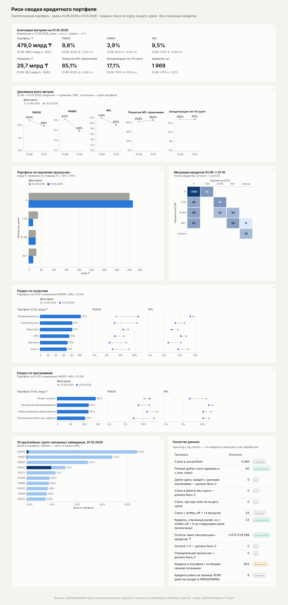

# Риск-сводка кредитного портфеля

PostgreSQL → семантическая модель (YAML) → дашборд на Vega-Lite по синтетическому портфелю на два среза: **01.09.2026** и **01.10.2026**.



## Как запустить

Нужны Docker (или локальный PostgreSQL 16 с `psql`) и, для сверки, Python 3 с `pandas` и `pyyaml`.

```bash
./run.sh                      # поднимает postgres:16 в docker compose и делает всё ниже
# или на своём Postgres:
PGHOST=localhost PGUSER=postgres PGDATABASE=risk ./run.sh --local

python3 -m http.server -d dashboard 8000   # дашборд: http://localhost:8000
```

`run.sh` по шагам (каждый можно запустить отдельно из корня репозитория):

| Шаг | Команда | Что делает |
|---|---|---|
| 1 | `psql -f sql/01_raw.sql` | схема `raw`, таблицы, `TRUNCATE` + `\copy` CSV в одной транзакции |
| 2 | `psql -f sql/02_reporting.sql` | схема `reporting`, все вьюхи через `CREATE OR REPLACE VIEW` |
| 3 | `scripts/export_dashboard_data.sh` | выгрузка вьюх в `dashboard/data/*.json` |
| 4 | `python3 tests/reconcile.py` | независимый пересчёт на pandas и сравнение с SQL |
| 5 | `python3 tests/check_model.py` | все колонки YAML-модели существуют во вьюхе-источнике |
| — | `python3 scripts/screenshot.py` | скриншот `docs/dashboard.png` (Playwright) |

Повторный запуск ничего не ломает и не задваивает: raw перезаливается целиком, вьюхи пересоздаются.

## Структура

```
data/                     portfolio.csv, fx.csv — исходники
sql/01_raw.sql            загрузка в raw (все поля text — типизация в reporting)
sql/02_reporting.sql      вьюхи reporting.*
semantic/portfolio.yml    семантическая модель поверх reporting.v_portfolio
dashboard/specs/*.vl.json 7 спеков Vega-Lite
dashboard/index.html      статичная страница, рисует спеки через vega-embed
dashboard/data/*.json     данные для спеков (выгрузка из вьюх)
tests/                    сверка цифр и проверка модели
CLAUDE.md, AI_NOTES.md    инструкции для ИИ и заметка об ошибках
```

Вьюхи в `reporting`:

| Вьюха | Назначение |
|---|---|
| `v_fx` | типизированные курсы |
| `v_loan_clean` | все кредиты на обе даты: без дублей, с курсом, `principal_kzt`, флагом `in_portfolio` |
| `v_portfolio` | **витрина**: только кредиты в портфеле, флаги PAR/NPL, суммы по категориям, ставка и сумма провизий |
| `v_metrics` | метрики на каждую дату (широкий формат) |
| `v_metrics_change` | те же метрики в длинном формате с изменением к 01.09 (п.п. для долей, % для сумм) |
| `v_breakdown` | разрезы по отрасли и программе |
| `v_top_groups` | ранжированные группы связанных заёмщиков |
| `v_dpd_migration` | матрица миграции корзин просрочки 01.09 → 01.10 |
| `v_dq_checks` | проверки качества данных |

## Определения и принятые решения

* **Портфель** — Σ `principal_outstanding` × курс USD/KZT **строго на дату среза** (478,35 на 01.09, 482,10 на 01.10), без списанных кредитов. Если курса на дату нет, берётся последний известный до неё — сейчас такого нет (`fx_not_on_report_date = 0`).
* **PAR30 / PAR90** — `days_past_due > 30` / `> 90`. Кредит ровно с 30 (90) днями в PAR30 (PAR90) не входит.
* **NPL** — `days_past_due > 90` **или** `restructured = 1`.
* **Провизии** — ставка по приоритету: NPL → 50%; иначе 31–90 дней → 10%; иначе (0–30 дней) → 1%. Реструктуризированный кредит без просрочки получает 50%, а не 1%.
* **Концентрация** — доля 10 крупнейших `group_id` (не заёмщиков) в портфеле на каждую дату.

Что пришлось решить по данным:

1. **Дубли.** В выгрузке 60 строк — полные дубли (30 на каждую дату). Убраны; конфликтующих дублей (тот же кредит с разными значениями) нет — это проверяется.
2. **«Воскресшие» списания.** 23 кредита со `written_off = 1` на 01.09 пришли на 01.10 с `written_off = 0` (5,68 млрд ₸), у 10 из них просрочка обнулилась. Списание необратимо, поэтому кредит, списанный на любом прошлом срезе, в портфель не возвращается (`written_off_ever`). Если брать флаг буквально, портфель на 01.10 был бы 484,67 млрд ₸, NPL — 10,01% вместо 9,51%, провизии — 31,17 млрд вместо 29,66.
3. **Истёкший срок.** 431 кредит в портфеле на 01.10 (96,9 млрд ₸) уже прошёл дату погашения, из них 375 (84,0 млрд) — с нулевой просрочкой. В метриках оставлены как есть, вынесены в проверки качества.

## Итоговые цифры

| Метрика | 01.09.2026 | 01.10.2026 | Изменение |
|---|---:|---:|---:|
| Портфель, млрд ₸ | 498,15 | 479,00 | −19,15 (−3,8%) |
| Кредитов, шт. | 1 975 | 1 969 | −6 |
| PAR30 | 12,05% | 9,83% | −2,22 п.п. |
| PAR90 | 6,24% | 3,90% | −2,34 п.п. |
| NPL | 11,85% | 9,51% | −2,34 п.п. |
| NPL, млрд ₸ | 59,04 | 45,57 | −13,46 |
| Провизии, млрд ₸ | 36,51 | 29,66 | −6,85 (−18,8%) |
| Провизии / портфель | 7,33% | 6,19% | −1,14 п.п. |
| Покрытие NPL провизиями | 61,8% | 65,1% | +3,2 п.п. |
| Концентрация топ-10 групп | 17,04% | 17,15% | +0,10 п.п. |

Валютная часть — 11,1–11,2% портфеля (USD); остальное в тенге.

## Три вывода для риск-комитета

**1. Улучшение NPL почти целиком держится на «излечении» 90+, которое стоит проверить, прежде чем засчитывать.** 53 кредита (14,90 млрд ₸) за месяц перешли из 90+ сразу в 0 дней просрочки — без реструктуризации и без заметного погашения долга (остаток снизился на те же ~4%, что у всего портфеля). Ещё 49 кредитов ушли из 31–90 в 0. Если применить к излеченным 90+ стандартный испытательный срок и оставить их в NPL, NPL на 01.10 — **12,6%**, то есть хуже, чем на 01.09, а недорезерв — около 7,3 млрд ₸. Рекомендация: подтвердить погашения по выпискам и ввести правило испытательного срока для выхода из NPL.

**2. Крупнейшая группа G0004 начала уходить в просрочку — это главный риск концентрации.** G0004 — 4,4% портфеля (21,0 млрд ₸), №1 по размеру. Её крупнейший кредит L001018 (7,79 млрд ₸, лизинг, промышленность) перешёл из 10 в 40 дней просрочки; только он поднял PAR30 промышленности с 8,5% до 16,3% — промышленность сейчас худшая отрасль по PAR30 при доле 22% портфеля. Выход L001018 в 90+ добавит **+1,6 п.п. к NPL** и **+3,1 млрд ₸ провизий**. Концентрация топ-10 стабильна (17,1%), но риск сидит в одном имени: нужен план по G0004 до 01.11.

**3. Данные источника требуют исправления, иначе отчётность нестабильна.** Списанные кредиты возвращаются в выгрузку как действующие (23 шт., 5,68 млрд ₸; при буквальном чтении флага NPL отличается на 0,5 п.п.), в выгрузке есть полные дубли строк, а 84 млрд ₸ числятся с нулевой просрочкой после даты погашения. Это вопросы к владельцу системы-источника: признак списания должен быть необратимым, а просрочка по истёкшим кредитам — считаться от даты погашения. Сейчас это компенсировано в витрине, но не исправлено в источнике.

## Как проверялись цифры

1. **Независимый пересчёт.** `tests/reconcile.py` считает метрики прямо из CSV на pandas, без SQL: свои дедупликация, курс, правило списания, ставки провизий и топ-10. Суммы — в `Decimal` с округлением half-up до копейки, как `numeric` в Postgres. Расхождение с `v_metrics` и `v_breakdown`: **0 ₸** по суммам, < 1e-16 по долям; изменения в `v_metrics_change` совпадают с разностью пересчитанных значений.
2. **Внутренняя согласованность.** Сумма разрезов по отраслям и по программам равна портфелю; кредитов на каждую дату 2 000 до исключения списанных.
3. **Граничные случаи.** Ручная проверка классификации на `days_past_due` = 30, 31, 90, 91 и реструктуризированных без просрочки (ставки 1% / 10% / 10% / 50% / 50%).
4. **Проверки качества данных** в `reporting.v_dq_checks`: проверки с ожидаемым нулём (конфликтующие дубли, отсутствующий курс, неположительный остаток, отрицательная просрочка) — все 0.
5. **Модель.** `tests/check_model.py` сверяет каждую колонку YAML со схемой `reporting.v_portfolio`.
6. **Идемпотентность.** Скрипты прогнаны дважды подряд и с нуля после `DROP SCHEMA … CASCADE` — результат тот же.
7. **Дашборд** отрисован в headless Chromium и просмотрен глазами в светлой и тёмной теме; цифры на карточках совпадают с `v_metrics_change`.
